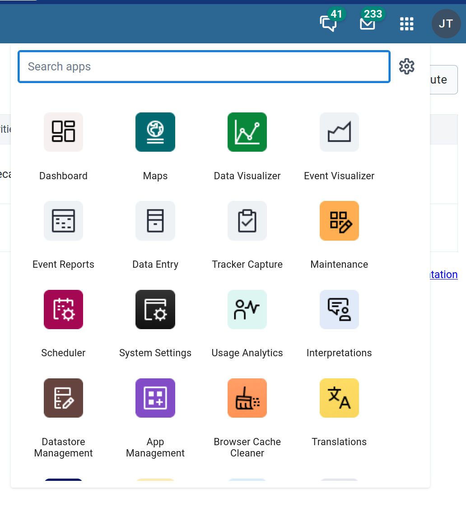
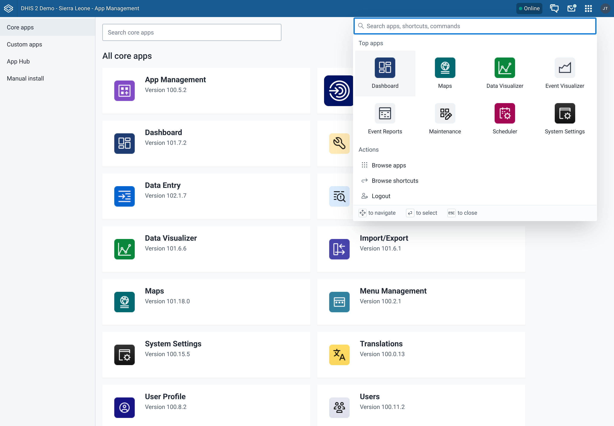
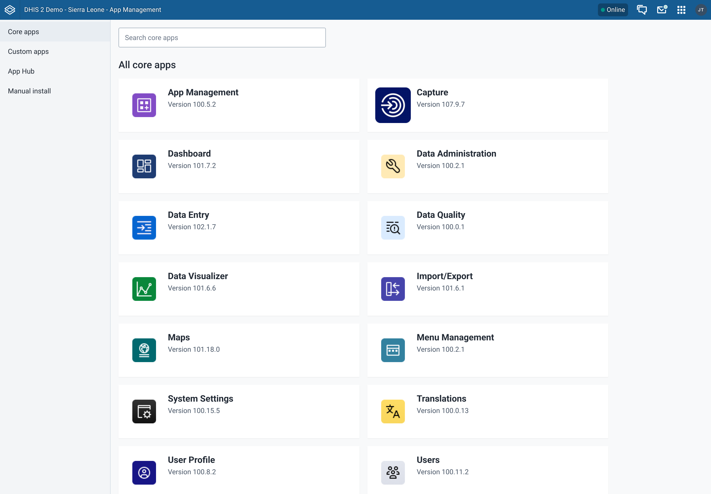
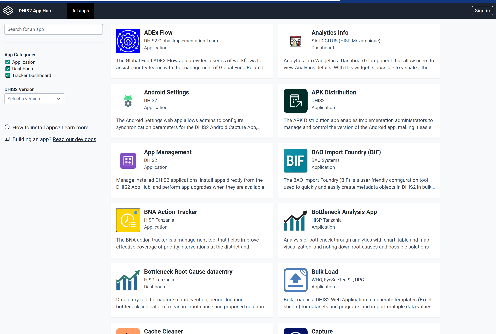
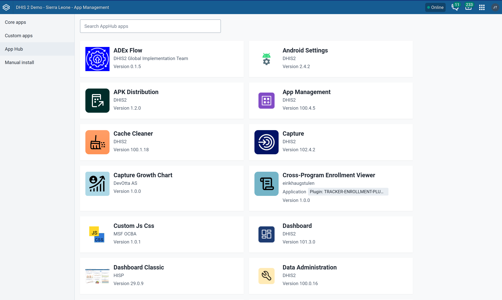
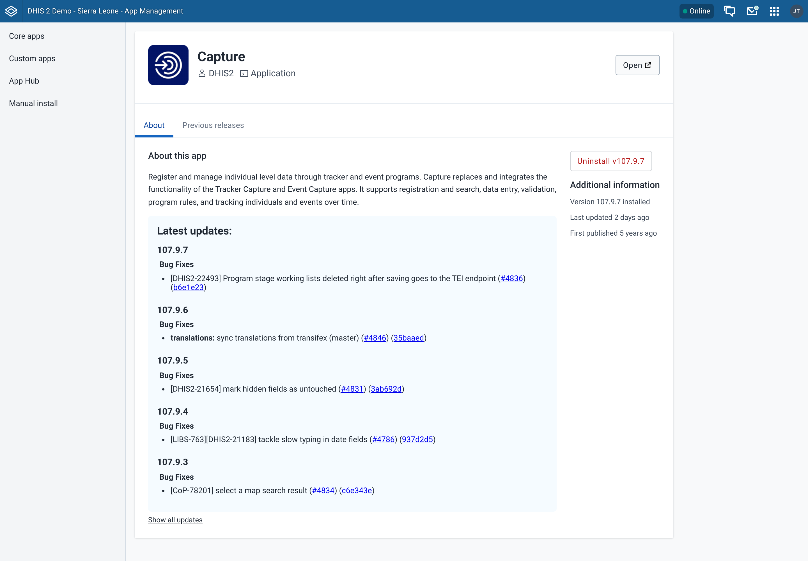
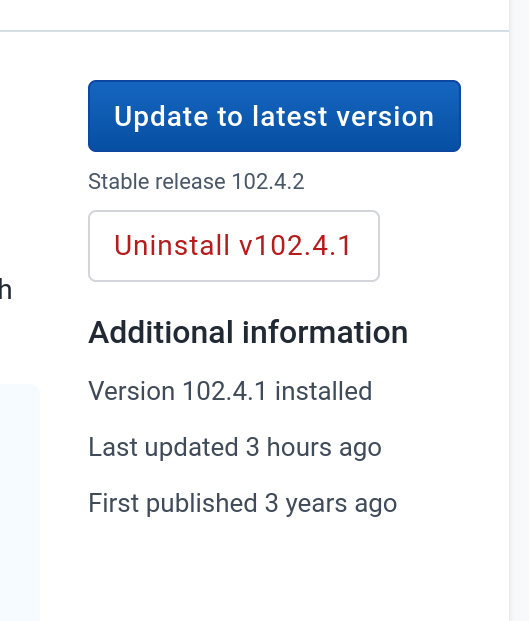
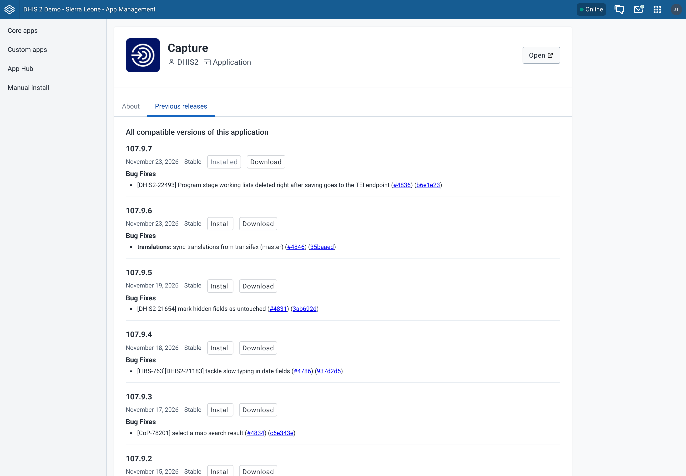

## Installing apps into DHIS2 { #apps_installing_apps }

Apps are one of the main ways to extend DHIS2. A DHIS2 installation includes around 30 _core_ apps.

You can open these apps from the search menu on the header bar (first image) or, in DHIS2 v42 and later, from the command palette (second image).

{ width=50% }

{ width=50% }

One of the core apps is the App Management app. Use it to install, update, delete, and maintain the apps on a DHIS2 instance. To install, update, or delete apps, a user role needs the **App Management app** authority.

The App Management app has four sections: **Core apps**, **Custom apps**, **App Hub**, and **Manual install**.

### Core apps

These are the apps that a DHIS2 installation includes. They provide core functionality of DHIS2, for example data entry (aggregate and tracker), maintenance, analytics, and visualization.

The **Core apps** section shows the installed apps and their versions. Apps with updates available are at the top.

### Custom apps

This section shows the apps that you installed from the **Manual install** section. Because you installed these apps manually, they can lack some information, such as their version and whether an update is available.

### App Hub

Besides the apps from the DHIS2 core team, a community of developers builds and maintains apps for DHIS2. You can find these apps on the App Hub: [https://apps.dhis2.org](https://apps.dhis2.org).

The **App Hub** section of the App Management app connects to the App Hub. Use it to install and manage the apps that are on the App Hub.

### Manual install

In this section, you can install an app by uploading a zip file that contains a DHIS2-compliant app. To start, click **Upload an app to install** and select the zip file. You can get the zip file from several sources, for example GitHub release pages, the App Hub, or the app developer.

For information on how to develop DHIS2 apps, see the developer documentation: [https://developers.dhis2.org/docs](https://developers.dhis2.org/docs).

## App details view

When you click an app in any section (**Core apps**, **Custom apps**, or **App Hub**), the app details view opens.

The top of the app details view shows the basic information about the app:

1. The app name
1. The app developer, with a link to the developer's page on the App Hub
1. The app type: most extensions are _web_ apps, but there are also other types, such as plugins (plugins for the Capture app, dashboard widgets, and other custom plugins)
1. A link to open the app, if the app is installed

### About the App

The **About** tab shows the app description from the developer. If the developer provides them, it also shows the latest updates to the app.

#### Latest updates

The **Latest updates** section shows the features and bug fixes that each version of the app added. Administrators can use it to decide whether to upgrade an app to a specific version.

This section shows information only if the developer provides it, either automatically through change logs or manually on the App Hub page of the app. The developer documentation describes both ways, for developers and organizations that want to add change logs to their app development process.

### Updating and uninstalling apps

On the right of the **About** tab, there are buttons to update and to uninstall the app. If you are note not using the latest version and would like to update, click **Update to latest version**. To remove the app completely, click **Uninstall**. The uninstall button shows the installed version, for example **Uninstall v1.2.3**.

{ width=50% }

### Launching Apps { #apps_launching_apps }

To open an installed app, click **Open** at the top of the app details view. You can also search for the app in the app menu or in the command palette (DHIS2 v42 and later). From App Management app version 100.5.0, the command palette also has a shortcut to each section of the App Management app. Type the section name, for example **Manual install**, and select **App Management > Manual install**.

### Previous Releases

The **Previous releases** tab shows more than the **Latest updates** section. It lists all versions of the app that are compatible with the DHIS2 version of the instance.

Each version entry shows its release channel and has **Install** and **Download** buttons. The button for the installed version shows **Installed** and is disabled. By default, the list shows only the **Stable** channel. If the app has versions in more than one release channel, select the **Channel** check boxes (**Stable**, **Development**, and **Canary**) to show those releases as well. You can install a downloaded zip file manually, but it is better to use **Install**. Then the App Management app keeps the history of the app and alerts you to future releases.

